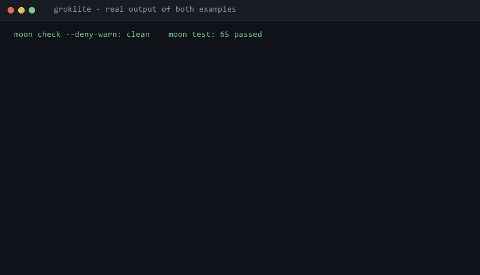

# groklite

> 中文一句话：把非结构化日志行按 grok 风格模式拆成命名字段，纯计算、无 IO、多目标可用。

A log line arrives as text and is wanted as strings keyed by name. Somewhere between
the process that prints it and the store that indexes it, somebody decides which part
of the line is the status code. That decision usually ends up inside a regular
expression the next person cannot read, cannot test, and cannot extend without
breaking three other services.

groklite keeps the decision in one place. A pattern names what to extract:

```
%{IP:client} %{WORD:method} %{NUMBER:status}
```

a registry gives each name a rule, and one call turns a line into fields. Patterns are
data, so adding a format is a table entry with a corpus line behind it, not a new
regular expression in a new service.

## Demo

One recording, captured from a real run of both examples:



The first block reads an access-log line; the second reads a syslog line with the
syslog family. Nothing in the recording is typed by hand.

## Install

```
moon add qqq66668/groklite
```

The module has one package with public exports, `qqq66668/groklite/src`. A consumer
declares it in `moon.pkg`:

```
import {
  "qqq66668/groklite/src" @groklite,
}
```

One call compiles a pattern against the curated rules; one call matches a line:

```moonbit
fn main {
  let pattern = "%{IP:client} %{WORD:method} %{STATUS:status}"
  match @groklite.compile_builtin(pattern) {
    Err(error) => println(@groklite.describe_compile_error(error))
    Ok(program) => {
      match @groklite.match_line(program, "10.0.0.7 GET 404") {
        Err(error) => println(@groklite.describe_match_error(error))
        Ok(fields) => {
          match @groklite.field_value(fields, "status") {
            Some(value) => println(value)
            None => println("no status field")
          }
        }
      }
    }
  }
}
```

It prints `404`. Those are the same three calls `examples/nginx_to_json` makes,
and continuous integration runs that example, so the shape of the call stays honest.

## Shape

Seven packages with one direction of dependency:

- `src/syntax` turns pattern text into ordered segments and reports offsets.
- `src/registry` maps a pattern name to a rule.
- `src/compile` expands references and lowers them into a matcher program.
- `src/engine` executes that program over one line.

`src` is the only package with public exports. `docs/design.md` states the invariants
and `docs/limits.md` states what the library refuses to do.

## What works today

Six capabilities, each covered by tests and exercised by the examples:

1. `parse` turns pattern text into literal and reference segments, and reports a
   malformed pattern with an offset and a caret line.
2. `builtin` ships 16 curated rules: the access-log core plus the syslog prefix.
3. `parse_rule` reads a rule body into a node tree: bracket classes, shorthand
   escapes, groups, alternation, anchors and bounded repetition.
4. `compile` lowers segments into a program with numbered capture slots and a field
   table, refusing a duplicate field, an unknown rule and a malformed body at
   compile time.
5. `match_line` runs a program over one line and returns a field table. Matching is
   whole-line: a partial match is a failure, not a best-effort result. Every pass is
   bounded by a step budget, and running out is reported rather than hidden.
6. `match_first` tries compiled programs in order and reports the first whole-line
   match, so a stream that mixes formats needs one pass instead of one branch per
   format.

65 tests cover those paths: unit tests beside each package, a corpus table that
drives the public facade, and the two examples continuous integration executes.

## Run the example

```
moon run examples/nginx_to_json
```

It prints the three fields of one access-log line:

```
client=10.0.0.7
method=GET
status=404
```

The same example runs in continuous integration, so this snippet is verified output, not
a claim. `src/corpus_test.mbt` is the black-box test file: it drives the public facade from a corpus
table of input line plus expected field map.

A stream normally mixes formats, so `match_first` takes compiled programs in order and
returns the first that matches the whole line, or one failure for the whole list. A step
budget failure stops the search instead of being read as a miss.
## A second format

A stream rarely carries one format. `examples/syslog_to_json` compiles two patterns and
tries them in order, printing the fields of the first one that matches the whole line:

```
moon run examples/syslog_to_json
```

```
pattern=0
ts=Jan  5 14:22:01
host=web-01
prog=sshd
msg=panic
```

Both examples run in continuous integration.

## Provenance

The pattern syntax follows grok, the form Logstash popularised: a rule name in braces,
optionally followed by the field it should fill. Several rule names in the built-in
registry (`WORD`, `NUMBER`, `INT`, `SPACE`, `NOTSPACE`, `HOST`, `IP`, `IPORHOST`,
`USER`, `MONTH`, `MONTHDAY`, `TIME`, `SYSLOGTIMESTAMP`, `PROG`, `SYSLOGBASE`) come from
the vocabulary of logstash-patterns-core
(https://github.com/logstash-plugins/logstash-patterns-core, Apache-2.0). Names such as
`STATUS` are written for this project.

No code and no pattern body is copied from that collection. Every rule here is written
in this repository, restricted to the grammar in `docs/limits.md`, and exercised by a row
in `src/corpus_test.mbt`. What is shared is the vocabulary, not the implementation; where
this library refuses a construct that collection relies on, `docs/limits.md` records the
refusal.

## Verify the claims

```
moon check --deny-warn
moon test
moon run examples/nginx_to_json
moon run examples/syslog_to_json
bash tools/check_no_pii.sh
```

Continuous integration runs the same five steps and then the suite again on each target in the matrix, so a claim that drifts away from the
code fails the build instead of aging quietly in this file.
## Beyond matching

Matching is one stage of a pipeline; the module ships the stages around it too.

```
let loader = assembler()                       // indented lines join the record
loader.continue_on("Caused by:")
let records = assemble(loader, lines)           // physical lines -> logical records

let state = stream(loader)                       // or push lines as they arrive
for line in lines {
  for record in feed(state, line) {
    // one record completed here
  }
}
let last = finish(state)                         // flush the open record
let program = compile_builtin(pattern)?
let report = analyze(program)                    // bounds and defects, no run needed
let fields = match_line(program, record_text(records[0]))?
let spec = contract()
spec.between("status", 100, 599)
let problems = validate(fields, spec)            // semantic violations, not silence
```

`analyze` answers questions a general matcher cannot: how many characters the
pattern can consume, how many steps the search can take, how long each field can
be, and whether the pattern contains a construct that cannot behave as written.
`validate` turns "the line matched" into "the fields mean what the caller needs",
reporting a missing field, a non-integer, an out-of-range status, a value outside
an enum, a length bound and an inverted cross-field order separately.
## Boundaries

No file input, no network input, no log shipping, no type coercion: a caller hands in
a string and gets a value back. The library is not a drop-in replacement for an
upstream pattern collection and makes no claim of parity with one. Every shipped
pattern carries a corpus line; anything else is not shipped.

## Licence

Apache-2.0. See `LICENSE`.